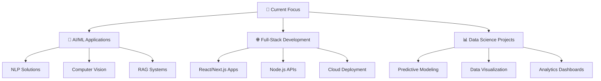

<h3 align="center">AI Engineer - Full Stack Developer</h3>

> *"I create websites and automate workflows for businesses to reduce their time and resources. While increasing their profits."*
<br>

```typescript
const avijat_chahar = {
    role: "Full-Stack Developer & AI Engineer",
    location: "Jaipur, India 🇮🇳",
    education: "B.Tech Artificial Intelligence & Data Science @ RIET, Jaipur",
    passion: ["Artificial Intelligence", "Problem Solving", "Chess", "Jogging"],
    currentFocus: "AuraBrandOS - Help founders create systems for brand and content creation",
    funFact: "I can cover 3KM in 15mins",
    philosophy: "Code with purpose, innovate with passion"
};
```
<!--
🔭 currently juicing [AuraBrandOS](https://github.com/AvijatChahar/AuraBrandOS)<br>
👨‍💻 [Portfolio](https://avijatchahar.github.io/Avijatchahar/)<br>
🚀 Founder of AVIJATlabs<br>
📝 I write articles on [My Blog](https://avijatchahar.github.io/Avijatchahar/blog.html)<br>
⚡  Fun fact - I love [chess](https://www.chess.com/member/avijatchahar) and football. <br>
🌍 Based in India<br>
-->

<h3>Languages and Tools</h3>
<div align="center">
<a href="https://www.linux.org/" target="_blank" rel="noreferrer">  </a>
<a href="https://www.python.org" target="_blank" rel="noreferrer">  </a>
<a href="https://www.typescriptlang.org/" target="_blank" rel="noreferrer">  </a>
<a href="https://www.gnu.org/software/bash/" target="_blank" rel="noreferrer">  </a>
<a href="https://www.docker.com/" target="_blank" rel="noreferrer">  </a>
<!-- <p>
<a href="https://developer.mozilla.org/en-US/docs/Web/JavaScript" target="_blank" rel="noreferrer">  </a> 
<a href="https://aws.amazon.com" target="_blank" rel="noreferrer">  </a> 
<a href="https://www.docker.com/" target="_blank" rel="noreferrer">  </a>
<a href="https://www.w3schools.com/css/" target="_blank" rel="noreferrer">  </a> 
<a href="https://www.djangoproject.com/" target="_blank" rel="noreferrer">  </a>  
<a href="https://expressjs.com" target="_blank" rel="noreferrer">  </a> <a href="https://firebase.google.com/" target="_blank" rel="noreferrer">  </a> <a href="https://cloud.google.com" target="_blank" rel="noreferrer">  </a> <a href="https://git-scm.com/" target="_blank" rel="noreferrer">  </a> <a href="https://www.w3.org/html/" target="_blank" rel="noreferrer">  </a>  <a href="https://www.mongodb.com/" target="_blank" rel="noreferrer">  </a> 
<a href="https://www.mysql.com/" target="_blank" rel="noreferrer">  </a> <a href="https://nextjs.org/" target="_blank" rel="noreferrer">  </a> <a href="https://nodejs.org" target="_blank" rel="noreferrer">  </a> <a href="https://pandas.pydata.org/" target="_blank" rel="noreferrer">  </a> <a href="https://www.postgresql.org" target="_blank" rel="noreferrer">  </a>  <a href="https://pytorch.org/" target="_blank" rel="noreferrer">  </a> <a href="https://reactjs.org/" target="_blank" rel="noreferrer">  </a> <a href="https://reactnative.dev/" target="_blank" rel="noreferrer">  </a> 
<a href="https://getbootstrap.com" target="_blank" rel="noreferrer">  </a> 
<a href="https://scikit-learn.org/" target="_blank" rel="noreferrer">  </a> <a href="https://tailwindcss.com/" target="_blank" rel="noreferrer">  </a> <a href="https://www.tensorflow.org" target="_blank" rel="noreferrer">  </a>  -->
</p>
</div>

    
<h3>Connect with me</h3>
<div align="left">
<p>
<a href="https://x.com/avijatchahar" target="blank"></a>
<a href="https://linkedin.com/in/avijatchahar" target="blank"></a>
<a href="https://instagram.com/avijatchahar" target="blank"></a>
<a href="https://www.youtube.com/c/avijatchahar" target="blank"></a>
<a href="mailto:avijat1chahar@gmail.com" target="blank"></a>
</p>
</div>


## 🏗️ Featured Projects

<table>
<tr>
<td width="50%">

### 🤖 AuraBrandOS (Still Cooking)
*Advanced NLP-powered Social Media Analytics Platform*

[](https://github.com/AvijatChahar/AuraBrandOS)


**🎯 Impact:**
- 📈 
- ⚡ 
- 🎨 

**Tech Arsenal:**
`Python` `Next.js` `REST APIs` `NLP`

</td>
<td width="50%">

### 📋 Air-Draw
*AI-Powered whiteboard work from hand gestures*

  [](https://github.com/AvijatChahar/Air-Draw) 
  [](https://air-draw-ashy.vercel.app/)

**🎯 Impact:**
- 🎯 60% boost in drawing accuracy
- ⏱️ 35% reduction in screening time
- 🚀 Streamlined handgesture recognision

**Tech Arsenal:**
`React` `tailwind css` `typescript` `vite` 

</td>
</tr>
</table>

---

### 🔐 *(Freelance Project)* Digital Signature Solution 
*Secure Web & Desktop Signature Management System for NZESSENTIALS*

<div align="center">


</div>

**Key Features:**
- 🔒 Secure signature capture & storage
- 🖥️ Cross-platform desktop application
- 🌐 RESTful API integration
- ✅ Digital signature verification

## 🏆 Achievements & Certifications

<div align="center">

<table>
<tr>
<td align="center" width="33%">

<br><strong>Intercollege Chess champion</strong>
<br><small> 100+ participants from 20+ colleges</small>
</td>
<td align="center" width="33%">

<br><strong>2nd Engineer's Day Quiz</strong>
<br><small>Technical problem-solving</small>
</td>
<td align="center" width="33%">

<br><strong>Hackathon Tech Incharge</strong>
<br><small>hosted Enigma 2026 at RIET, jaipur</small>
</td>
</td>
</tr>
</table>


## 🎯 Current Focus Areas

<div align="center">



</div>

## 📊 GitHub Stats
<div align="center">


 <br>

</div>    


<div align="left">
<h3>Connect with me</h3>

---

<p>
<a href="https://x.com/avijatchahar" target="blank"></a>
<a href="https://linkedin.com/in/avijatchahar" target="blank"></a>
<a href="https://instagram.com/avijatchahar" target="blank"></a>
<a href="https://www.youtube.com/c/avijatchahar" target="blank"></a>
<a href="mailto:avijat1chahar@gmail.com" target="blank"></a>
</p>
</div>

### 💬 Open for

---

<div align="center">
    
🚀 **Exciting Project Collaborations** & ☕ **Tech Discussions over Coffee**<br>
💼 **Full-Stack Development Roles**<br>
🎯 **Freelance Projects**<br>


---

<sub>💖 Crafted with passion and a lot of ☕ by Avijat Chahar.</sub>


</div>

